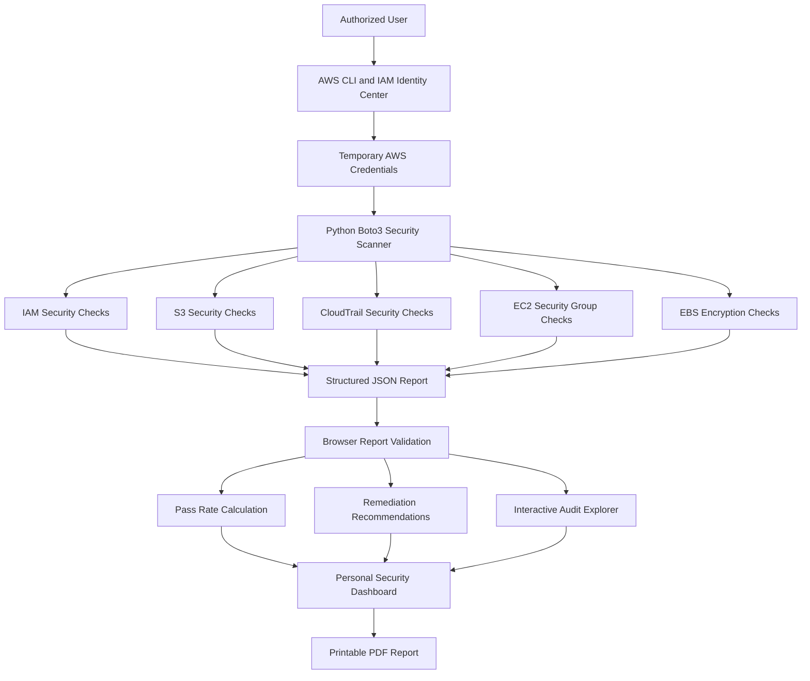
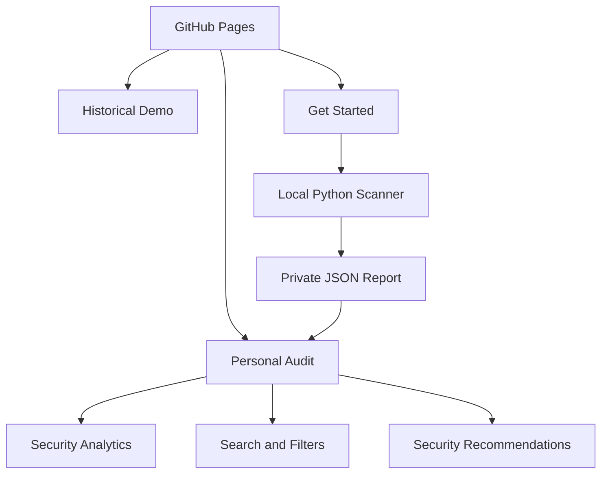
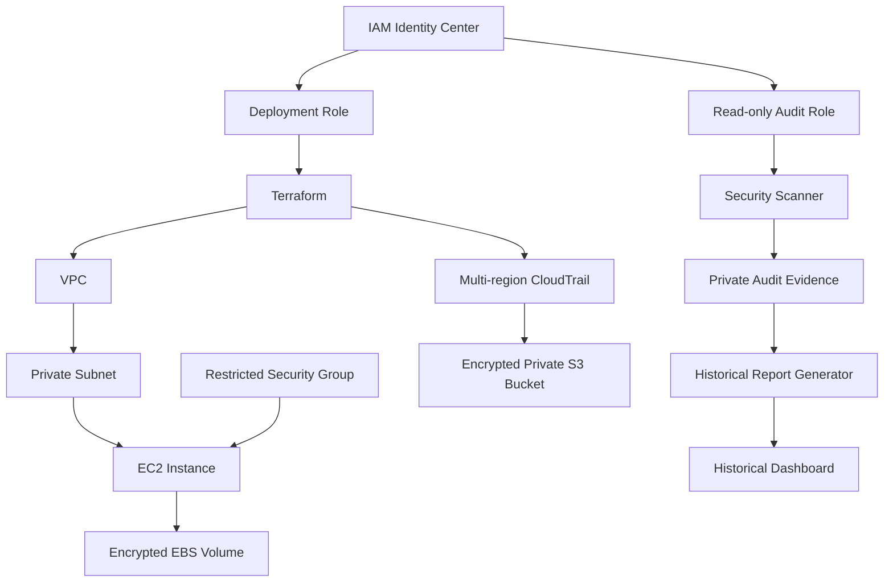

# CloudGuard X — System Architecture

## Architecture Overview

CloudGuard X combines AWS infrastructure security,
automated security assessments, structured JSON reporting,
and client-side security visualization.

The platform operates without a dedicated backend server
or report database.

## System Architecture



## Website Architecture



## Historical AWS Lab Infrastructure



## Core Components

| Component | Responsibility |
|---|---|
| scanner.py | Read-only AWS security assessment |
| generate_report.py | Historical dashboard generation |
| index.html | Historical assessment visualization |
| personal-audit.html | Personal report import interface |
| audit.js | Report validation, analytics and recommendations |
| audit.css | Responsive design and animations |
| get-started.html | User installation guide |
| terraform/main.tf | Historical lab infrastructure configuration |

## Security Architecture

- Temporary AWS authentication through IAM Identity Center.
- Separation of deployment and audit permissions.
- Read-only AWS API operations during assessments.
- Client-side report processing.
- Content Security Policy on the personal audit page.
- JSON structure and finding validation.
- Maximum report size of 5 MiB.
- Safe text rendering of imported findings.
- Independent pass rate recalculation.
- No server-side report storage.
- No automatic AWS remediation.

## Assessment Workflow

1. Authenticate using an authorized AWS profile.
2. Execute the scanner against the selected AWS region.
3. Generate a structured JSON assessment report.
4. Import the report into the Personal Audit page.
5. Validate and process the report locally in the browser.
6. Calculate security metrics from recorded findings.
7. Display domain analytics and recommendations.
8. Review, filter or export the assessment.

## Security Testing

The following controlled application security tests passed:

- Malformed JSON rejection.
- Invalid schema rejection.
- Controlled XSS input handling.
- Oversized file rejection.
- Manipulated score recalculation.

These tests do not constitute a comprehensive
penetration test or prove report authenticity.

## Infrastructure Lifecycle

The AWS lab infrastructure was deployed and assessed
to demonstrate security configuration and remediation.

The lab resources were destroyed after testing.
Historical assessment evidence is retained privately.

Terraform deployment is not required for personal
security assessments.

## Limitations

- Selected AWS security checks only.
- Regional checks cover the selected region.
- Missing permissions may interrupt an assessment.
- Imported findings are not independently authenticated.
- Historical results do not represent live AWS monitoring.
- Cross-account and cross-platform testing remains limited.
- SOC 2-inspired, not SOC 2 certified.
```
